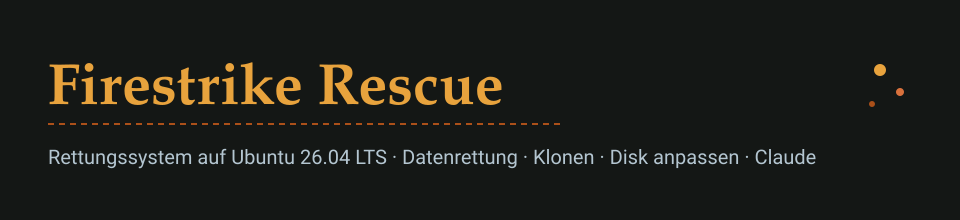

<p align="center"></p>

Firestrike Rescue ist ein bootfähiges Rettungssystem auf Basis von **Ubuntu 26.04 LTS**. Es ist mit allen Updates gebaut und bringt die wichtigen Werkzeuge mit. Ein Assistent führt Schritt für Schritt durch drei Aufgaben:

- **Datenrettung** von defekten Disks. Zuerst entsteht immer ein Image auf einer Ziel-Disk, dann geht es mit dem Image weiter.
- **Klonen**, z. B. von HDD auf SSD. Die Größe wird automatisch angepasst, auch auf kleinere Ziele.
- **Disk anpassen**: Partitionen vergrößern oder verkleinern, GPT reparieren, sicher löschen.

**Claude** ist an Bord, als Claude Code CLI und als Claude Desktop. Auf dem Stick gibt es einen kleinen, verschlüsselten Speicher für Configs, `CLAUDE.md` und Logins.

Herunterladen
-------------

Fertige ISOs gibt es unter [Releases](../../releases). Jeden Monat entsteht automatisch ein neuer Build mit allen Ubuntu-Updates.

Die ISO kommt **im DD-Modus** auf einen USB-Stick. Empfohlen sind mindestens 8 GB, damit Platz für den persistenten Speicher bleibt.

- **Windows:** [Rufus](https://rufus.ie). ISO wählen, Rufus fragt nach dem Modus, „DD-Image“ wählen.
- **Linux/macOS:** `sudo dd if=firestrike-rescue-*.iso of=/dev/sdX bs=4M status=progress conv=fsync`
- So prüfst du die Herkunft: `gh attestation verify firestrike-rescue-*.iso --repo Celestial0579/firestrike-rescue`

Der Stick startet per UEFI (auch mit Secure Boot) und per Legacy-BIOS.

Bedienung
---------

Nach dem Start erscheint der Assistent und zeigt alle Disks mit ihrem SMART-Zustand. Er schlägt dann den passenden Weg vor. Die ausführliche Anleitung steht in [docs/anleitung.md](docs/anleitung.md).

```
GERÄT     ZUSTAND  MODELL                       GRÖSSE     SERIENNUMMER         BUS
sda       [DEFEKT] WDC WD10EZEX-08WN4A0         931.5GiB   WD-WCC6Y0ABCDEF      sata
          12 schwebende Sektoren, 140 Lesefehler im Kernel-Log
nvme0n1   [OK]     Samsung SSD 990 PRO 2TB      1.8TiB     S7DNNJ0W123456       nvme
```

Diese Schutzregeln gelten immer:

- Quell-Disks werden sofort auf Kernelebene schreibgeschützt.
- Ziele werden über die Seriennummer bestätigt. Du gibst die letzten 4 Zeichen ein, nicht `/dev/sdX`.
- Fremde Disks werden nie automatisch eingehängt. Auch Swap, RAID und LVM werden nicht automatisch aktiviert.
- Reparaturen laufen nur auf einer Kopie des Images.

Was ist drin
------------

| Bereich | Werkzeuge |
|---|---|
| Rettung | ddrescue, ddrescueview, safecopy, testdisk/photorec, foremost, sleuthkit, ewf-tools |
| Diagnose | smartmontools, nvme-cli, hdparm, memtester, memtest86+, stress-ng, lshw |
| Klonen | partclone, fsarchiver, clonezilla, qemu-img (VHDX), wimtools |
| Dateisysteme | NTFS, ext2–4, XFS, Btrfs, exFAT, FAT, F2FS, HFS+, LVM, mdadm, LUKS, BitLocker (dislocker) |
| Windows | chntpw, efibootmgr, ms-sys |
| Netz | NetworkManager (nmtui, WLAN), SSH (auf Wunsch), rsync, rclone, SMB, NFS |
| Claude | Claude Code CLI, Claude Desktop (offizielles Anthropic-Paket, Linux-Beta) |

Selbst bauen
------------

Den Build übernimmt GitHub Actions (`.github/workflows/build.yml`). Lokal braucht es einen Ubuntu-26.04-Host oder Docker:

```bash
docker run --rm --privileged -v "$PWD:/src" ubuntu:26.04 /src/build/build.sh
```

Die ISO landet in `out/`.

| Datei | Zweck |
|---|---|
| `build/build.sh` | debootstrap → chroot → SquashFS → Hybrid-ISO (xorriso) |
| `build/packages.list` | Paketliste |
| `build/chroot-setup.sh` | Pakete, Claude, Sicherheits-Defaults |
| `build/grub/` | Bootmenü und Theme |
| `rescue/frs` | Assistent, Bibliotheken in `rescue/lib/` |
| `rescue/claude/CLAUDE.md` | Regeln für Claude im Rettungssystem |
| `tests/qemu-smoke.sh` | Boot-Tests (UEFI, BIOS, Selbsttest mit simulierter defekter Disk) |

Design
------

Farben und Schriften stammen von [firestrike.de](https://firestrike.de). Sie gelten für das Bootmenü, die Konsole (per `setvtrgb`) und die Dialoge:

| Grund | Text | Stahl | Stahl hell | Funke | Glut | Akzent |
|---|---|---|---|---|---|---|
| `#141715` | `#E8EBE7` | `#33414B` | `#B4C6D1` | `#E8A33D` | `#AB5019` | `#D9713C` |

Lizenz
------

MIT, © 2026 Tim Heyne. Siehe [LICENSE](LICENSE). Die enthaltenen Ubuntu-Pakete und Claude stehen unter ihren eigenen Lizenzen.
